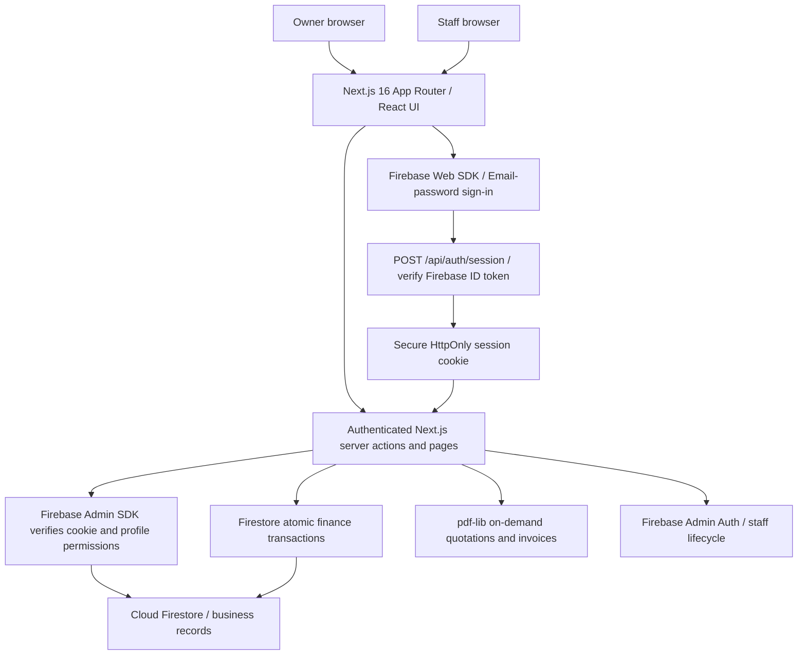
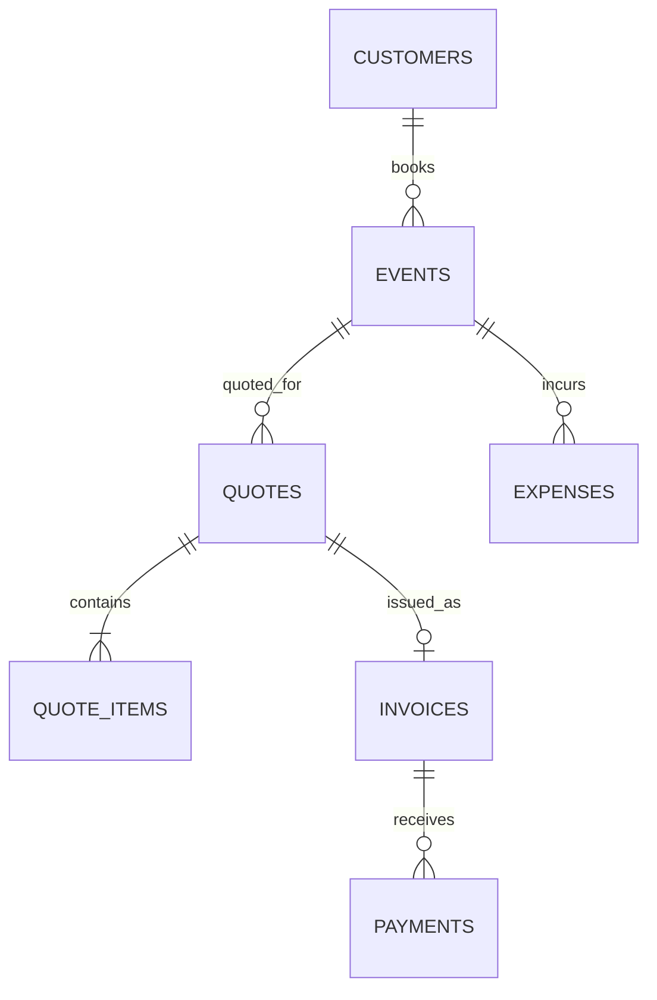

# CaterFlow Pro — Firebase architecture (Phase 1)

## System architecture



- **UI/backend:** Next.js 16 App Router, React, TypeScript, Tailwind v4, server actions, Node.js PDF routes.
- **Authentication:** Firebase Authentication (email/password) via client Web SDK. The client exchanges its fresh ID token for an HttpOnly, SameSite=Lax cookie with a 5-day lifetime; the server verifies that cookie (and revocation) before any protected request.
- **Access control:** `profiles/{uid}` contains `role` (`owner|staff`) and `status` (`active|disabled|pending`); `requireOwner` guards all financial and team server actions and routes. `requireUser` guards shared customer and event management. The Firebase Admin SDK can bypass Firestore rules, so all calls must remain server-only.
- **Client rules:** Firestore and Storage rules deny direct reads/writes. No database SDK is shipped to the browser, except the Firebase Auth client.
- **Database:** Firebase Cloud Firestore. Amounts are displayed in PKR. Invoice balances are updated in transactions to prevent overpayment and concurrent writes.
- **Files:** Quotations/invoices are generated as PDFs server-side. Firebase Storage is initialized but **image uploads are not yet part of Phase 1**; keep Storage rules closed until implemented.
- **Deployment:** Vercel or other Next.js Node hosting; use server-only Firebase service account variables.

## Firestore document structure

```text
businesses/main                  company name, address, phone, email, currency
profiles/{firebaseUid}          full_name, email, role, status, created_at
customers/{uuid}                full_name, phone, email, address, notes
packages/{uuid}                 name, category, description, price_per_person, active
events/{uuid}                   customer_id, title, date, venue, guest_count, status, times
quotes/{uuid}                   event_id, discount, tax_rate, total, status, notes
quote_items/{uuid}              quote_id, category, description, quantity, unit_price
invoices/{quoteUuid}            quote_id, event_id, invoice_no, amount, paid_amount, status
payments/{uuid}                 invoice_id, amount, paid_at, method, reference, notes
expenses/{uuid}                 event_id, category, vendor_name, amount, incurred_at
counters/invoices               next (sequential internal invoice counter)
```

### Logical entity relationships (Firestore stores reference IDs, not enforced foreign keys)



- Customer/event and event/expense references are checked on creation; creating a quote verifies the event in a transaction.
- One accepted quotation is invoiced at most once: the invoice document ID is the quotation's UUID. This is enforced atomically.
- `invoice_no` is assigned with `counters/invoices` in the same invoice transaction.
- Historical quote items store snapshot prices; changing a package doesn't alter a saved quotation.
- Quote invoice total is computed at quote creation; invoice amount is a snapshot of that total.
- `invoice.paid_amount` and invoice status are changed with each new payment in a Firestore transaction, protecting the remaining balance against concurrent payments.
- All document IDs are UUIDs except Firebase Auth profile UIDs, `businesses/main`, `counters/invoices`.
- All operational dates are `YYYY-MM-DD` strings; time-of-day fields are local strings. Timestamps are ISO strings.

## Permissions

| Operation | Owner | Active staff | Pending, disabled or anonymous |
|---|---|---|---|
| Customer/event read and edit | Yes | Yes | No |
| Read packages | Yes | Yes | No |
| Create/edit packages | Yes | No | No |
| Quotes, invoices, payments, expenses, profits | Yes | No | No |
| Business settings | Yes | No | No |
| Create/disable/enable staff | Yes | No | No |
| Generate quote/invoice PDF | Yes | No | No |

### Security notes

- Do not expose the Firebase service-account private key in `NEXT_PUBLIC_*`, client code, logs or source control.
- Owner creation is performed only through the one-time local bootstrap script. The UI exposes no public signup. Firebase Email/Password APIs may still permit creation of unprofiled Auth accounts; such accounts cannot obtain app sessions or access Firestore. Consider Authentication blocking functions / Identity Platform if you need to prevent even Auth-account creation.
- Staff are created with a temporary password chosen by the owner, which must be shared securely. The owner should ask staff to change it using the app's Change password screen. No invitation email is automatically sent.
- Disabled staff profiles fail on their next request, even if an old browser cookie exists; Firebase Auth account is also disabled and refresh tokens revoked.
- The session-creation API enforces same-origin requests, a recent Firebase sign-in, and a live active profile.
- Read/write rules block direct browser Firestore access; admin-mediated server handlers are the sole access path.

## MVP constraints / next improvements

- This is for **one company** and its relatively small dataset. The read adapter currently retrieves a collection and filters/sorts in the **server process**; for larger datasets use indexed Firestore queries, cursor pagination, and explicit aggregation counters. Monitor Firestore reads/costs.
- The proposal's second-phase decoration workflows, equipment reservations, staff/vendor scheduling and customer portal are not built yet.
- Image upload/Storage workflow is not built; restrictive Storage rules are intentional.
- No accounting ledger, payment refunds/edits, audit trail, automated invoice email, or automatic inventory double-booking prevention yet.
- The application checks ownership roles server-side, but should undergo live Firebase security tests, concurrency tests, accessibility tests, and a production build prior to deployment.
- For stronger password onboarding, replace manual temporary-password handoff with a tested transactional email service and single-use activation links.
